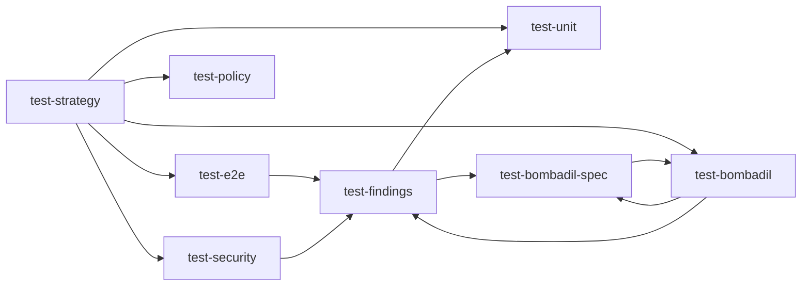

# test-skills

[](https://agentskills.io/specification)
[](https://github.com/vercel-labs/skills)
[](https://skills.sh)
[](LICENSE)

**test-skills** is a set of [Agent Skills](https://agentskills.io) for testing applications:
choosing what to test, writing tests that fail for the right reasons, exploring a UI with
[Bombadil](https://github.com/antithesishq/bombadil) and triaging what the runs find.

Each skill is a plain `SKILL.md` folder that works in any agent supporting the open
specification. Descriptions stay in context; detailed guidance and references load when needed.

## Quick start

```sh
npx skills add emiliodominguez/test-skills
```

Pick your skills and agents in the installer, then give your agent a task:

```text
test-bombadil Set up Bombadil for this app. Run the defaults headless for two minutes,
fix anything that makes them fail on a healthy build, and report the commands.
```

<sub>Requires Node.js 22.20.0+ for the <a href="https://github.com/vercel-labs/skills">skills CLI</a>.</sub>

## The skills

| Stage       | Skill                                                      | What moves forward                                                                        |
| ----------- | ---------------------------------------------------------- | ----------------------------------------------------------------------------------------- |
| **Plan**    | [`test-strategy`](skills/test-strategy/SKILL.md)           | A risk table: layer, oracle and cadence per risk, plus a maintenance contract.            |
| **Author**  | [`test-unit`](skills/test-unit/SKILL.md)                   | High-signal unit and in-process flow tests on the pure core, no mocks of the unit.        |
| **Author**  | [`test-e2e`](skills/test-e2e/SKILL.md)                     | Scripted tours of critical paths: isolated, fenced, semantic locators, no blind retries.  |
| **Author**  | [`test-policy`](skills/test-policy/SKILL.md)               | Repository-reading tests for conventions: boundaries, i18n parity, docs, banned patterns. |
| **Author**  | [`test-security`](skills/test-security/SKILL.md)           | Schema-driven hostile input and an authorization matrix over every procedure.             |
| **Explore** | [`test-bombadil`](skills/test-bombadil/SKILL.md)           | Bombadil installed, harnessed and run on a cadence, with replayable traces.               |
| **Author**  | [`test-bombadil-spec`](skills/test-bombadil-spec/SKILL.md) | Bombadil properties and replayable action generators.                                     |
| **Triage**  | [`test-findings`](skills/test-findings/SKILL.md)           | Reproduced, confirmed, shrunk and classified findings, pinned by regression tests.        |

Scripted tours prove the paths you know; property-based exploration checks invariants on the
paths nobody wrote down. The suite treats them as complementary layers.



<details>
<summary><strong>Copy a prompt and try it</strong></summary>

**Map risks to layers**

```text
test-strategy Audit this repository's tests. List the risks they miss, the layer and oracle
for each, and what runs on every change versus on a schedule.
```

**Write a property**

```text
test-bombadil-spec Add a property that the cart total equals the sum of its lines, and a
generator that can finish checkout. Run the spec for five minutes and show it reached the cart.
```

**Triage a violation**

```text
test-findings Bombadil reported cartTotalAddsUp was violated in out/bombadil/checkout.
Reproduce it, shrink it, and tell me whether the app or the property is wrong.
```

</details>

## Profiles

Install a focused slice, or combine profiles. Membership lives in [`profiles.json`](profiles.json).

| Profile     | Skills                                      |
| ----------- | ------------------------------------------- |
| `core`      | strategy, unit, e2e, findings               |
| `bombadil`  | strategy, bombadil, bombadil-spec, findings |
| `hardening` | policy, security, findings                  |

```sh
./install.sh --profile bombadil -- -a <agent> -y
```

<details>
<summary><strong>Install options</strong></summary>

| Goal                                | Command                                                                               |
| ----------------------------------- | ------------------------------------------------------------------------------------- |
| Pick skills and agents in a prompt  | `npx skills add emiliodominguez/test-skills`                                          |
| Install for your user, not the repo | `npx skills add emiliodominguez/test-skills -g -a <agent> -y`                         |
| Install specific skills             | `npx skills add emiliodominguez/test-skills --skill test-bombadil test-bombadil-spec` |
| See what is available               | `npx skills add emiliodominguez/test-skills --list`                                   |
| Update or remove later              | `npx skills update` / `npx skills remove`                                             |

From a clone, the wrappers accept profiles and pass everything after `--` to `npx skills`:

```sh
./install.sh --project -- -a <agent> -y   # current project, one agent
./install.sh --local -- -a <agent> -y     # install from your clone
./uninstall.sh --dry-run                  # preview removal of every test-* skill
./uninstall.sh --profile hardening        # remove one profile
```

For global installs, pass an explicit `-a` list: automatic agent selection can include agents
that only support project installs.

The `.claude-plugin/` folder is an optional marketplace channel; `npx skills` is the recommended
install path.

</details>

## Tools

The skills name testing tools where the tool is the point (Bombadil, axe-core) and stay neutral
elsewhere, describing runners and frameworks by category. They name no agent host or model.
Bombadil guidance targets 0.7.x; see the
[gotchas](skills/test-bombadil/references/gotchas.md) before upgrading.

## Contributing

```sh
pnpm install --frozen-lockfile
pnpm check
```

The gate checks formatting, types, skill validation and tests. See [CONTRIBUTING.md](CONTRIBUTING.md)
and [authoring](docs/AUTHORING.md).

## License

[MIT](LICENSE)
